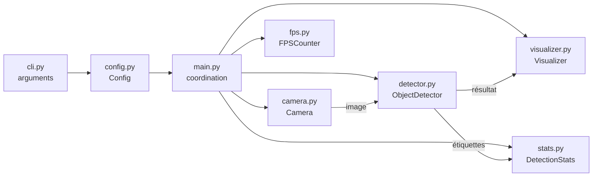

# Architecture

## Vue d'ensemble

L'application suit une boucle simple : lire une image, la passer au modèle, afficher le résultat. Chaque étape est isolée dans son propre module.

## Modules

| Module | Rôle |
| --- | --- |
| `main.py` | Construit les objets et lance le mode adapté (`run_stream` ou `run_image`). Renvoie un code de sortie. |
| `cli.py` | Analyse la ligne de commande et produit un objet `Config`. Valide le seuil de confiance. |
| `config.py` | Dataclass immuable `Config` ; sait si la source est une image (`is_image`). |
| `camera.py` | Encapsule `cv2.VideoCapture` pour une webcam ou un fichier vidéo. |
| `detector.py` | Charge le modèle YOLO, valide les entrées, renvoie les résultats ; `extract_labels` liste les classes détectées. |
| `visualizer.py` | Annote l'image, affiche FPS et nombre d'objets, gère la touche `q`. |
| `fps.py` | Calcule un FPS lissé ; l'horloge est injectable pour les tests. |
| `stats.py` | Cumule les détections par classe et produit le résumé de session. |

## Flux d'exécution

1. `main()` lit la configuration depuis la ligne de commande.
2. Si la source est une image, `run_image` la lit, détecte et affiche une fois.
3. Sinon, `run_stream` ouvre la source et boucle : lecture, détection, mise à jour des statistiques, affichage.
4. La boucle s'arrête sur `q`, sur `Ctrl+C`, à la fin d'une vidéo ou si la webcam cesse de répondre.
5. Les ressources sont libérées (`finally`) et le résumé de session est journalisé.

## Choix de conception

- **Séparation des responsabilités** : on peut remplacer le détecteur ou l'affichage sans toucher au reste.
- **Injection de dépendances** : `run_stream` et `run_image` reçoivent leurs objets en paramètres, ce qui permet de les tester avec des mocks.
- **Codes de sortie** : `0` en cas de succès, `1` en cas d'erreur, utilisables par des scripts.
- **Statistiques cumulées** : un objet visible pendant 100 images compte 100 fois. Compter des objets uniques demanderait du suivi (tracking).
- **Tests sans dépendances lourdes** : le modèle YOLO, la caméra et les fenêtres OpenCV sont simulés.

## Extensions possibles

- Un nouveau détecteur : implémenter une classe avec la même méthode `detect`.
- Une nouvelle sortie (fichier, réseau) : ajouter un module appelé depuis `run_stream`.